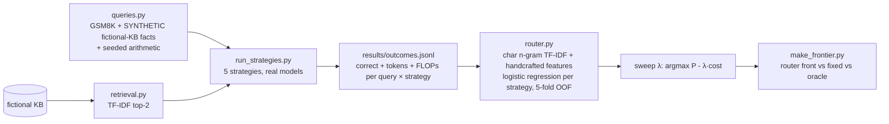

# adaptive-compute-router

A per-query router that picks how much compute to spend on each question: **direct answer**,
**chain-of-thought**, **retrieval**, **verifier** (CoT checked by a calculator program), or a
**bigger model**. A lightweight classifier predicts each strategy's chance of being right from the
question text. The router trades that against cost and is scored on the cost-accuracy Pareto frontier
against every fixed strategy and an oracle.

> **Status: pipeline built and tested; the model runs have NOT been done yet.** This repo has no
> accuracy or frontier numbers. Collecting outcomes needs Qwen2.5-0.5B-Instruct and
> Qwen2.5-1.5B-Instruct runs on 180 queries. That was not possible on this shared 16 GB Mac at the
> time (heavy swap from parallel jobs). See *Limits*.

## Why

Spending the same compute on every query wastes it. "What is 37 + 48?" doesn't need a reasoning
trace, and a question about a private fact needs retrieval, not a bigger model. Routing by predicted
difficulty is the cheapest way to move along the cost-accuracy curve. The test is whether a router
built from query text alone beats the best fixed strategy at equal cost.

## Architecture



## How it works

- **Query pool** (`acr/queries.py`): 60 GSM8K test problems (multi-step math), 60 questions about a
  **synthetic** fictional knowledge base (unanswerable without retrieval), and 60 seeded one-step
  arithmetic questions. The KB and arithmetic items are synthetic; the outcomes would come from real
  model runs.
- **Strategies** (`acr/strategies.py`): `direct` (0.5B, ≤32 tokens), `cot` (0.5B, ≤320),
  `retrieval` (0.5B + top-2 TF-IDF passages), `verifier` (0.5B CoT + program-of-thought through a
  safe calculator; the tool's answer wins on disagreement), `bigger` (1.5B CoT).
  Cost = 2 × non-embedding params × tokens processed.
- **Grading** (`acr/grading.py`): numbers are compared by value; names by normalized containment.
- **Router** (`acr/router.py`): out-of-fold P(correct) per strategy from character n-grams plus 8
  handcrafted features, using 5 folds stratified by family. The router picks
  argmax P(s) − λ·cost(s), where cost is each strategy's mean cost, normalized. Sweeping λ traces
  its frontier. The oracle picks the cheapest correct strategy per query.

```bash
make setup
make test        # 12 tests, ~7 s, no LLM needed
make outcomes    # runs both models on 180 queries -> results/outcomes.jsonl (not yet run)
make frontier    # results/frontier.json + results/REPORT.md
```

## Results

**None yet.** `make outcomes` has not been run, so there are no accuracy, cost or frontier numbers.
The unit tests check the router's mechanics on hand-made labels: the out-of-fold classifier
separates arithmetic from fact questions, λ moves choices to cheaper strategies, and dominated points
are dropped from the frontier. These are tests, not results.

## Limits

- **No model results yet** (see Status).
- Two of the three query families are synthetic and easy to tell apart from the text. That makes
  routing easier than on real traffic. A real evaluation needs mixed queries from one distribution.
- 180 queries with 5-fold CV gives noisy frontiers. Each fold trains on 144 queries.
- Cost counts forward FLOPs only. It ignores latency, batching and the retriever's own cost.
- The 1.5B "bigger model" is still small. The gap to a frontier model is much larger.
